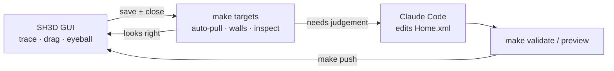

# SweetHome3D workflow: GUI, `make`, or Claude Code?

Describing a home in [Sweet Home 3D](https://www.sweethome3d.com/) (SH3D) mixes three kinds of work. Each has a
cheapest tool:

| Kind of work | Best tool | LLM tokens |
|---|---|---|
| Spatial and visual work: tracing, dragging, picking from the catalogue, eyeballing | **SH3D GUI** | 0 |
| Deterministic work: unpack/repack, validate, list, render, generate walls | **`make` targets** in this repo | 0 |
| Judgement over many elements or exact numbers: measured fixes, bulk edits, model surgery, debugging | **Claude Code** | worth it |

The repo turns a `.sh3d` file (a ZIP) into a git-tracked, unpacked tree (`sh3d_src/<home>/Home.xml` plus model
entries). This lets the GUI and text-based tools take turns on the same home with history and backups.

## Recommended sequence

| # | Step | Tool | Why there |
|---|---|---|---|
| 1 | Import the plan raster as each level's background image and set its scale | GUI | One drag of the scale line is cheaper than any prompt. (`make preprocess` can rasterise PDFs to `work/<floor>.png`.) |
| 2 | Trace a few walls and all rooms over the background | GUI | Tracing is spatial. The traced walls also set the pixel↔cm transform that the walls tools use. |
| 3 | `make walls-overlay NAME=<home>` | make | Draws traced walls over the background and prints an ink-hit rate, which catches a bad scale before you build on it. |
| 4 | `make walls-rooms NAME=<home>` | make | Dry run: walls derived from the gaps between rooms, drawn per level under `work/walls/` for review. |
| 5 | `make walls NAME=<home>` | make | Writes those walls into `Home.xml`, tagged. A re-run replaces only tagged walls you haven't edited, and walls you deleted in the GUI stay deleted. Run it early: once walls are corrected by hand, prefer targeted edits over regenerating. |
| 6 | Correct the geometry against on-site measurements | Claude Code | Exact numbers across many walls and rooms are where an LLM beats dragging. Plan drawings can be off by tens of cm. |
| 7 | Furniture, doors, windows, materials | GUI first | Catalogue picking and placement are visual. Hand Claude only the bulk or numeric part (align a row, repaint every wall on a level, trim an OBJ model). |
| 8 | `make push NAME=<home>`, then reopen in SH3D and eyeball | make → GUI | The final check is visual and free in the GUI. |

## The edit loop

1. Save in SH3D and **close the file**.
2. Any of `make validate|inspect|preview|walls-overlay|walls-rooms|walls NAME=<home>` **auto-pulls**. A GUI save
   newer than the last pull gets unpacked into `sh3d_src/<home>/` and committed there first. It refuses (and
   overwrites nothing) if the tree has uncommitted or unpushed edits.
3. Edit `Home.xml` (yourself or via Claude Code), then `make validate NAME=<home>` checks it against the DTD built
   from the SH3D sources.
4. `make push NAME=<home>` repacks the `.sh3d`. It refuses if the GUI saved since the last pull (both sides would
   hold edits) and backs up the old file to `backups/` first. It prints the Windows path to reopen.

## Token-efficiency rules for Claude Code

- **Run deterministic steps yourself.** Every `make` target above costs 0 tokens in a terminal. Asking Claude to run
  one costs its output plus the reasoning around it.
- **Ground Claude with `make inspect`, not raw XML.** It prints compact tables (levels, walls, rooms, furniture,
  doors/windows, unhandled tags) with the ids Claude needs to target an edit. `Home.xml` itself is far larger.
- **Use `make preview` sparingly.** It renders a per-level plan to `work/sh3d/<home>/preview.png`, and reading an
  image costs tokens. Use it for a geometry sanity check after a bulk edit, not after every change. Leave the
  eyeballing to the GUI.
- **Batch edits.** Collect a list (e.g. "these 12 walls, measured in cm"), then run one edit pass, one
  `validate`, and one commit. Each round trip re-reads the conversation context.
- **Give numbers, not descriptions.** "Wall `<id>` end at x=…, thickness 12" is cheap. "Move that wall a bit
  left" makes Claude reconstruct the geometry first.
- **Keep spatial intent in the GUI.** If a change is easier to drag than to describe, drag it.
- **Use Claude Code for the parts that need judgement:** reconciling measurements with traced geometry, edits
  that touch many elements consistently, OBJ model surgery (see `.claude/rules/sh3d-models.md`), reading a
  `validate` failure, and extending the tooling itself.

## Command reference

| Command | Does |
|---|---|
| `make pull NAME=<home>` | Unpack `homes/<home>.sh3d` → `sh3d_src/<home>/` (explicit form of the auto-pull) |
| `make inspect NAME=<home>` | Compact tables of the home's contents |
| `make validate NAME=<home>` | DTD-check `Home.xml` |
| `make preview NAME=<home>` | Render the plan to `work/sh3d/<home>/preview.png` |
| `make walls-overlay NAME=<home>` | Traced walls on each level image, plus ink-hit rate |
| `make walls-rooms NAME=<home>` | Dry run of the room-gap walls |
| `make walls NAME=<home>` | Write the room-gap walls (tagged) into `Home.xml` |
| `make push NAME=<home>` | Back up, repack, print the path to reopen |
